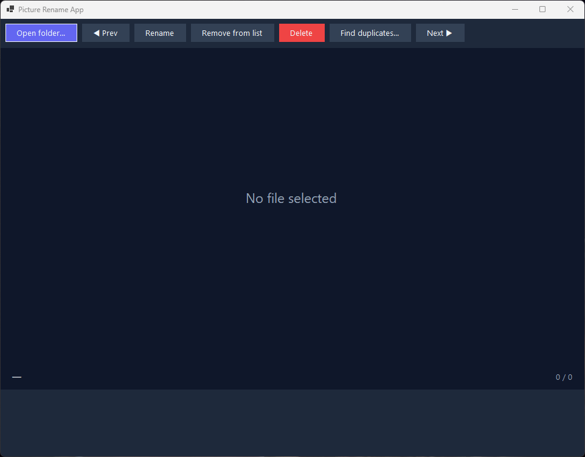
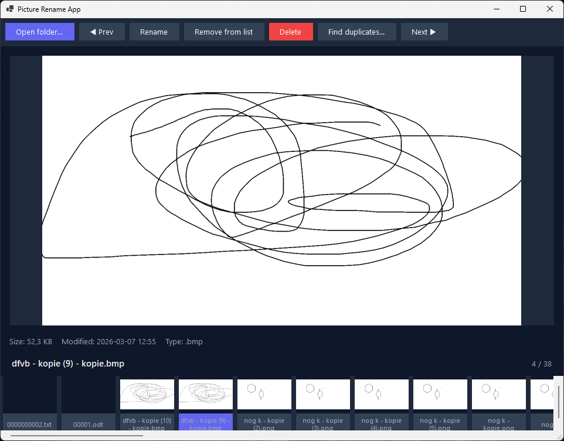
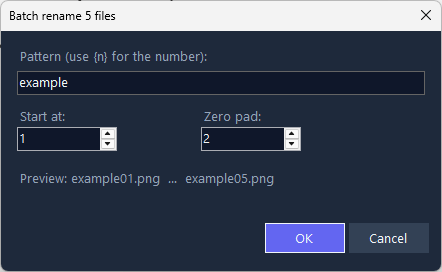
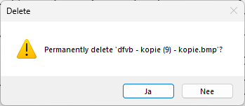

# Picture Rename App

[](https://github.com/SDormans/PictureRenameApp/actions/workflows/build.yml)

A lightweight, fast Windows desktop application (WinForms) for browsing, previewing, and renaming image files. Picture Rename App simplifies single and batch renaming, helps find duplicates, and supports safe file operations with clear user confirmations.

Target platform: Windows (WinForms), .NET 8

---

## Overview

Picture Rename App provides a simple, focused UI to:

- Browse directories and view image thumbnails
- Preview images and view metadata (size, dimensions, EXIF date taken and camera)
- Rename a single file or perform batch renames with automatic numbering and `{name}` / `{date}` placeholders
- Undo the last rename or batch rename (**Undo rename** or Ctrl+Z)
- Optionally move batch-renamed files into a dedicated subfolder named after the chosen base name
- Remove files from the current list or delete them from disk (Recycle Bin by default, prompted)
- Find exact duplicates and look-alikes (resized, re-saved or very similar pictures) and review them one group at a time, choosing which file to keep
- Remember preferences (subfolder default, Recycle Bin, zero padding, last folder, find duplicates after opening) in a settings file

The project emphasizes reliability, predictable behavior, and efficient memory use when handling large image collections.

Full documentation (user guide, rename patterns, duplicate review, settings, architecture, development) is in the [wiki](docs/wiki/Home.md).

---

## Screenshots









---

## Quick Start (Developer)

### Prerequisites

- .NET 8 SDK
- Windows (WinForms desktop application)
- Optional: Visual Studio 2022/2023 or Visual Studio Code

### Build and run

```bash
# Restore and build
dotnet restore
dotnet build

# Run the application
dotnet run --project PictureRenameApp.csproj
```

Alternatively, open the project in Visual Studio and run the `PictureRenameApp` project.

### Run tests

```bash
dotnet test PictureRenameApp.Tests/PictureRenameApp.Tests.csproj
```

The tests need Windows (the test host uses the Windows Desktop runtime). CI runs build and tests on `windows-latest` for every push to `master` and every pull request.

---

## Usage (End-user)

1. Click **Open folder…** to choose a directory with images. The last folder is reopened on the next start (can be turned off in **Settings…**).
2. Thumbnails are generated; click any thumbnail to preview the image and metadata.
3. Use **Rename** for single or batch renames. Batch renames use a pattern such as `Holiday {n}`; by default the renamed files are moved into a subfolder named after the base name (`./Holiday/`). Untick **Move into subfolder** in the dialog, or change the default in **Settings…**, to rename in place.
   Placeholders: `{n}` number, `{name}` original file name, `{date}` date taken (EXIF, falling back to the modified date) as `yyyy-MM-dd`, or `{date:yyyyMMdd}` with any .NET date format. Example: `{date} {name}` → `2024-05-01 IMG_1234 01.jpg`.
   Use **Undo rename** (Ctrl+Z) to move the files of the last rename back; a subfolder created by that rename is removed again if it ends up empty.
4. Use **Remove from list** to remove files from the displayed list. The prompt lets you either keep them on disk or delete them.
5. Use **Delete** to delete files. By default they go to the Recycle Bin; switch to permanent deletion in **Settings…**.
6. Use **Review duplicates…**, or tick **Find duplicates after opening** so it starts when you open a folder. Identical files and look-alikes are shown one group at a time; the suggested file (highest resolution, then largest) is pre-selected. Click the picture to keep and press **Keep selected** (Enter), or **Keep all (skip)**. **Back** changes an earlier choice. Nothing is deleted until the summary at the end, where **Delete N file(s)** removes the others (Recycle Bin by default).

### Keyboard and mouse

| Action | Shortcut |
|---|---|
| Previous / next picture | ← / → |
| Rename (batch rename when several thumbnails are selected) | F2 |
| Undo last rename | Ctrl+Z |
| Delete | Delete |
| Select several thumbnails | Ctrl+click (toggle), Shift+click (range) |
| Duplicate review: switch picture / keep / back | ← → / Enter / Backspace |

Notes

- The app always confirms before deleting.
- Settings are stored in `%APPDATA%\PictureRenameApp\settings.json`.

---

## Architecture (Developer)

The running app is the WinForms code at the repo root; `MainForm.cs` holds the application logic. The dependency-injection layer (`Controllers/`, `Services/`, `Models/`) is registered in `Program.cs` but not yet used by the UI.

| Location | Contents |
|---|---|
| `Program.cs` | Entry point; builds the DI container and starts `MainForm` |
| `MainForm.cs` | Main window: thumbnail strip, preview, toolbar, rename / delete / undo, duplicate scan |
| `RenameDialog.cs`, `BatchRenameDialog.cs`, `SettingsDialog.cs`, `DuplicateReviewForm.cs` | Dialogs |
| `RenamePattern.cs`, `RenameOperation.cs` | Rename placeholders, subfolder naming, undo log |
| `ImageMetadata.cs`, `ExifParser.cs` | Dimensions, EXIF date taken and camera |
| `PerceptualHash.cs`, `ImageFingerprint.cs`, `DuplicateGrouper.cs`, `DuplicateReviewSession.cs` | Look-alike detection, grouping and review state |
| `AppSettings.cs` | Persisted user settings (JSON) |
| `Theme.cs` | Colors |
| `Controllers/`, `Services/`, `Models/`, `ServiceConfiguration.cs` | DI layer (not yet wired into the UI) |
| `PictureRenameApp/Configuration/AppConstants.cs`, `PictureRenameApp/Utilities/`, `Utilities/` | Constants, extension methods, `LRUCache`, shared helpers |
| `PictureRenameApp.Tests/` | xUnit tests |

See [Architecture](docs/wiki/Architecture.md) for details.

Design highlights:

- Thumbnails load in the background with limited concurrency and are cancelled when a new folder is opened
- File hashes and image fingerprints are cached by path, size and modified time
- Logic with no UI dependency (rename patterns, undo, EXIF parsing, duplicate grouping) is kept in small classes with unit tests

---

## Notable Behaviors

- Batch rename: by default creates a subfolder with the chosen base name and moves renamed files into it (re-running on files already in that subfolder does not nest it again)
- Remove action: prompts to either remove from list or delete; the delete path confirms again before removing files
- Delete: sends files to the Recycle Bin unless permanent deletion is chosen in Settings
- Thumbnail generation: optimized for speed and memory using controlled concurrency and lower-quality rendering suitable for thumbnails
- Duplicate review: never deletes during the review; files that changed since the scan are left alone

---

## Contributing

Contributions are welcome. Please follow standard GitHub workflow:

1. Fork the repository
2. Create a branch for your feature or bugfix
3. Add tests and update documentation where appropriate
4. Run `dotnet build` and `dotnet test`
5. Submit a pull request

Please add a `CONTRIBUTING.md` if you want project-specific contributor guidelines.

---

## License

No license file has been added yet.

---

## Contact / Support

If you need support or want to report an issue, open an issue in this repository. Include screenshots and steps to reproduce the problem.

---

